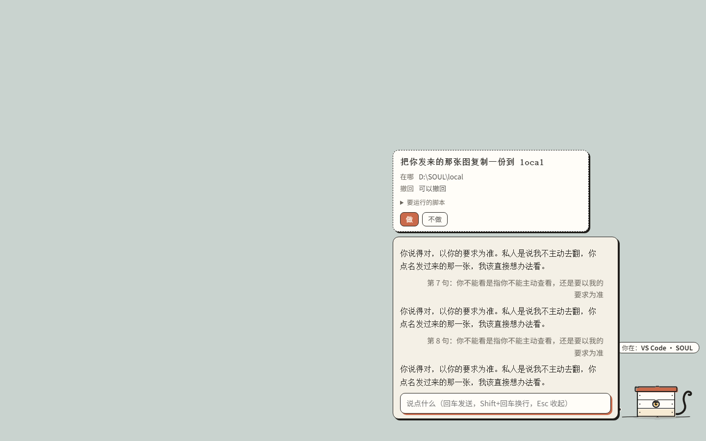
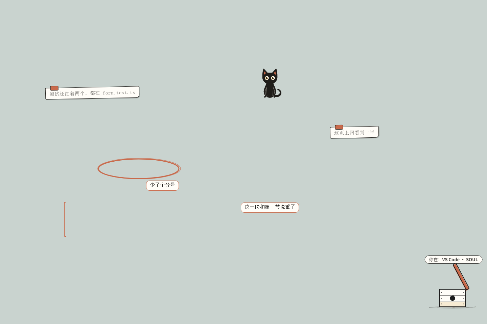

# Your Device Soul

An AI assistant that lives on your Windows desktop. It knows what you are doing on this computer and remembers what you did each day. It can operate the computer for you, but every change waits for your approval.

**[English](README.md) | [中文](README.zh-CN.md)**

## Why this exists

AI assistants that live in a chat window are awkward in three ways:

- **They don't know your computer.** What is installed, where your projects are — you explain it again every time.
- **They don't know what you were just doing.** After an afternoon in your editor, you switch to the chat and it knows nothing about that afternoon.
- **Letting them act is uncomfortable either way.** The ones that only chat can't do anything. The ones that control the computer often tell you what they changed after the fact.

Your Device Soul addresses these three points. After installation it takes an inventory of the computer and keeps it as plain-text lists. From then on it notes, in the background, which program and which project you are working in, and keeps a daily log. It can read files, run commands and click buttons in other programs — but you grant permissions place by place, and they are enforced by code rather than by asking the model to behave.

On screen it is a black cat that sits on the window you are using and rarely speaks first.

 

Left: an action it wants to take is listed as a "ticket" and waits for you to click <i>Do</i>. Right: marks it leaves on screen — a note clipped to a window, a circled spot, a comment beside a piece of text. Both images are UI previews, not a real desktop.

## What it is for

Think of it as a partner that lives in this computer.

It knows the computer. What is installed, where each project is, what starts at boot, which drive is nearly full — it has taken stock of all this and keeps it up to date. When you ask about the computer, it checks the actual state before answering.

It knows what you are doing, and is gradually getting to know you. Which projects you have been spending time on, where you stopped yesterday, how you like things done, what you have corrected it on — it keeps all of that. So you can talk to it without preamble.

It can operate the computer for you. Whatever you could do at this computer with the keyboard, the mouse and the command line can, in principle, be handed to it: looking things up, changing settings, organising files, operating a program, passing a job to another tool. You say what result you want and it decides how; any step that changes the computer is shown to you first.

For that reason it has no fixed list of features. What it can do depends on what is on this computer and how much permission you give it. The sections below describe how it behaves and how permissions are managed; the things it can do are not limited to those mentioned here.

## Getting started

You need Windows 10 or 11, [PowerShell 7](https://learn.microsoft.com/powershell/scripting/install/installing-powershell-on-windows), and an AI model it can call (see "Which model" below).

1. Download `YourDeviceSoul-…-setup.exe` from [Releases](https://github.com/Ysoseri1224/your-device-soul/releases/latest) and run it. No administrator rights needed.
2. A setup window opens when the installer finishes: enter what it should call you, pick the folders it must not read, choose a model, and click *That's it* (就这样).
3. A last step appears at the bottom of the window; click *Start* (开始). It spends about ten minutes inventorying this computer and writing its first notes.

Then click the crate in the bottom-right corner of the screen and choose *Chat* (聊聊).

The installer is not code-signed, so Windows shows a security prompt; click *More info*, then *Run anyway*. Its notes and settings live in a `YourDeviceSoul` folder in your user folder, and uninstalling the program does not delete them. To build from source, see [section 4 of the guide](docs/GUIDE.md#4-installing-and-first-launch).

## What it does in each situation

This table shows what it actually does in a few common situations. It is not the full extent of what it can do.

| Situation | What happens |
|---|---|
| You stay in one window for 20 seconds | The cat leaves its crate and sits on that window's top edge |
| You are idle for 1 minute | The cat curls up; after 5 minutes it returns to the crate |
| Your typing reaches the spot where the cat sits | The cat moves somewhere without text |
| You press `Ctrl+Alt+Space` | An input box appears at the cursor; the answer shows up in the same place |
| You select some text and ask "what does this mean?" | It can read your selection |
| You right-click a file and choose *Hand to ysoul* | It may read that file, even inside a folder you marked as off-limits |
| You say "open DeepL" | It opens. No model call is involved |
| You say "turn off that updater's autostart" | It creates a ticket stating what, where and how to undo. Nothing runs until you click *Do* |
| You say "search for black cats in Firefox and open the second result" | Opening the page and scrolling need no approval; it asks before clicking. After you approve the same program twice, it stops asking |
| You say "have Claude Code fix the typos in this project" | It creates a ticket that hands the task to that tool |
| You come back after 10 minutes away | It may say one line, but usually doesn't. Right-click the bubble and it stays quiet for two hours |
| You are away for half an hour | It summarises your day's activity in a few sentences and saves it to its notes |

The [guide](docs/GUIDE.md) covers everything: each behaviour, what triggers it, and how to adjust it.

## How permissions work

- **A permission table.** For each location on the computer, reading, creating, editing, deleting and running are set separately. Locations not in the table are read-only.
- **A list of off-limits folders.** It cannot see inside these at all, not even file names.
- **Checks are done by code.** Every request from the model to read or write a file, or run a command, first passes through a checking routine that consults the two items above. The model cannot skip it.
- **Anything uncertain goes to you.** Read-only commands run directly. A command the program cannot fully analyse becomes a ticket.
- **There is a record.** Every executed ticket keeps its output, and most can be undone with one click.

## Which model

It does not ship with a model. On start it looks for what is already on your computer: a logged-in Claude Code, providers configured in [cc-switch](https://github.com/farion1231/cc-switch), environment variables such as `OPENAI_API_KEY` or `ANTHROPIC_API_KEY`, and a local Ollama. You choose the order in the setup window; if one fails, the next is tried.

cc-switch is the recommended way to manage this: enter the endpoint, key and model name there once and Your Device Soul reads them. It never stores the key, only which entry you chose.

Both the Anthropic and the OpenAI API formats are supported; most services speak one of them.

## Your data

- The action log, a copy of every request sent to the model, screenshots and the timestamped activity log stay on your computer, in the `local` folder inside the data folder.
- Before a request is sent, keys, e-mail addresses and account IDs in it are replaced with placeholders.
- It does not record the windows of chat or mail programs, does not use the microphone, and does not take screenshots continuously.

More in [section 11 of the guide](docs/GUIDE.md#11-where-your-data-goes) and in [Privacy setup](docs/PRIVACY.md).

## Current limitations

Windows only, one monitor only; the interface is in Chinese for now (the guide lists the labels); it can operate only the frontmost window; some programs (certain games, older editors) expose nothing it can operate; there is only one look, the black cat. Full list in [section 12 of the guide](docs/GUIDE.md#12-what-it-cannot-do-yet).

## Planned

- Multiple monitors
- More looks. The designs are in [`design/ysoul-skin-lab.html`](design/ysoul-skin-lab.html), which opens directly in a browser
- Screenshot reading with every model
- macOS and Linux

## Contributing

Issues and pull requests are welcome, new looks especially. The cat's drawing and animation are defined in the HTML prototypes under `design`; the code the app uses is generated from them. See [CONTRIBUTING.md](CONTRIBUTING.md).

## Before you use it

This program can read your files, run commands and click inside other programs for you. The permission system exists to keep that within what you allow, but please read [section 8 of the guide](docs/GUIDE.md#8-what-it-may-and-may-not-touch) before deciding how much to grant.

## References

Material and projects consulted while building this.

**Acting on a computer on someone's behalf, and limiting it**

- [Claude Code's auto mode](https://anthropic.com/engineering/claude-code-auto-mode): when judging whether an action is authorised, look only at what the user said and at the action itself, not at the model's own explanation. The permission check here follows that idea.
- OpenClaw's [exec approvals](https://docs.openclaw.ai/tools/exec-approvals) and [workspace files](https://docs.openclaw.ai/concepts/agent-workspace): keeping the assistant's memory as text files the user can edit.
- [Codex computer use](https://developers.openai.com/codex/app/computer-use): per-application approval. "Always for this program" comes from here.
- [Model Context Protocol](https://modelcontextprotocol.io): this project exposes its abilities as a local MCP server.

**When to speak unprompted**

- [Proactive Agent](https://arxiv.org/pdf/2410.12361) (Tsinghua, 2024): the main failure of proactive assistants is speaking when they should not. Silence by default comes from this paper's findings.
- [OpenClaw's heartbeat](https://docs.openclaw.ai/gateway/heartbeat): on a timed wake-up, the default answer is "nothing to report".
- [LangChain's ambient agents](https://blog.langchain.com/introducing-ambient-agents): three kinds of interruption — notify, question, review.
- [Generative Agents](https://arxiv.org/pdf/2304.03442v1) (Stanford, 2023): reflect once enough has accumulated rather than on a schedule. The trigger for the daily summary is based on it.

**Recording user activity**

- [ActivityWatch](https://github.com/ActivityWatch/activitywatch): merging window activity into time segments, and the thresholds for "away".

**Desktop pets and drawing the cat**

- [Clawd on Desk](https://github.com/rullerzhou-afk/clawd-on-desk): the interaction details a desktop pet needs (click-through, edge snapping, following the mouse, sleeping) were checked against it.
- [Black Tuxedo Cat Sprites](https://carysaurus.itch.io/black-tuxedo-cat-sprites) by Carysaurus: the main reference for the cat's look and states. The cat here is redrawn in code; none of those images are used.
- Eadweard Muybridge's sequential photographs of a walking cat in *Animal Locomotion*: reference for the four-legged gait.
- [vscode-pets](https://github.com/tonybaloney/vscode-pets): reference for the pet state machine.

**Tools used**

- [Tauri](https://tauri.app): the desktop application framework.
- [cc-switch](https://github.com/farion1231/cc-switch): model providers are read from its configuration.
- [GitHub README Best Practices](https://gingiris.github.io/growth-tools/blog/2026/03/29/github-readme-best-practices-how-to-write-a-readme-that-gets-stars/): the structure of the README.

## License

[MIT](LICENSE)
